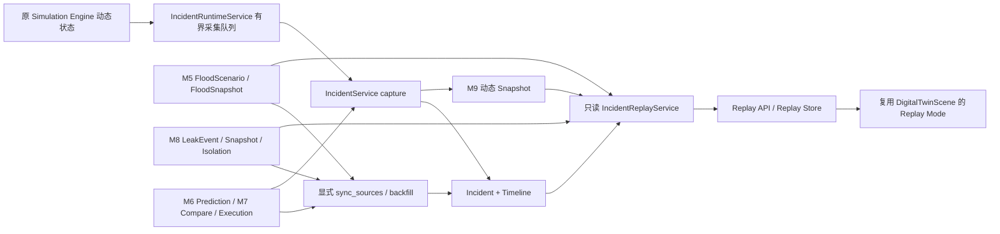

# M9 事故档案与历史回放架构

## 数据链路

M9 在 M5–M8 的源表之上增加统一业务索引，不更换原仿真器、管网图、预测模型或应急执行引擎。



只读查询不会运行 Simulator，也不会向实时设备、阀门或 Realtime Store 写入状态。前端以持久化样本驱动时间轴和画面，相邻样本的连续量可以插值；设备运行状态、阀门、入口、泄漏排名和处置步骤采用历史离散状态。

## 统一模型与源数据关系

迁移 `9fdda90bd972` 的 parent 是 M8 `f6f65d1e093a`，由当前 ORM metadata 通过 Alembic autogenerate 生成。

- `incidents`：类型、源标识、场景标识、位置、关键时间、状态、观测峰值和人工关闭结果。唯一约束 `(incident_type, source_event_id)`。
- `incident_timeline_events`：原始事件时间、仿真相对秒、事件种类、来源标识和 payload。唯一约束 `(incident_id, event_type, source_id)`。
- `incident_snapshots`：完整动态状态补充表。唯一约束 `(incident_id, simulation_time, state_hash)`，允许暂停时同一仿真秒保存动作前后两种不同状态。
- `work_orders`：字符串班组及严格状态机，默认主工单以 `(incident_id, category)` 去重。
- `review_reports`：模板生成的 Web 报告及生成时指标对象，一个档案保留最新报告。

这些表通过外键关联事故档案，没有业务 Delete Incident API，也没有为删除事故配置历史级联删除。

Flood 的 `source_event_id` 等于 M5 `FloodScenarioRecord.id`。Leak 的 `source_event_id` 等于 M8 `PipelineLeakEvent.id`，其独立 `scenario_id` 用于关联 M8 采样和隔离记录。Incident 和 Timeline 的 ID 根据业务标识确定性生成；业务编号带日期及 UUID，数据库另有唯一约束。

## 实时采集与旧历史回填

`IncidentRuntimeService.observe()` 观察原实时状态，不改变仿真。普通动态快照约每 5 墙钟秒入队；设备状态或故障、阀门状态、风险等级、入口、泄漏阶段、应急步骤等离散变化额外采样。

队列上限 128，后台串行落库，失败保留待写队列并显示存储错误。超限会丢弃最旧待写项并累计 `dropped`，不会补造丢失观测。读 API 不写数据库，打开 `/review` 不会产生重复时间轴。

`IncidentService.capture(state)` 使用独立数据库事务，允许原 M5/M8 sampler 尚未先写源事件时直接创建索引。它还定向聚合当前场景已保存的 M6 预测、M7 比较/执行或 M8 隔离记录，不每 5 秒扫描全部历史。

`scripts/backfill-incidents.py` 明确执行 `sync_sources(session)`。回填包括 Flood、Leak、Emergency 和 RiskPrediction 原表；重复执行通过业务唯一标识保持幂等。启动时也执行索引检查；不能恢复的旧活动事故由 runtime 标记 ABORTED。M5 的停止状态没有完整历史业务闭环信息，首次回填已停止的旧记录按中断处理；不将其标为 CLOSED。

## 动态快照内容

`scene_state` 保持现有 camelCase 动态字段，以便复用场景更新器：

- `weather`、`environment`；
- `devices`：ID、运行/故障状态、温度/振动/电流/转速/效率/健康、启动过渡和当时分析；设备名称仍由静态资产提供；
- `pipelines`：ID、管网类型、压力、流量、管段状态与观测端点值；
- `valves`：ID、开闭状态、开度；
- `flood`：雨量、水位、面积、进出流、有效泵能力、规则风险、入口和暴露；
- `leak`：压力、流量、检测、规则风险、疑似排序、影响范围、停水及隔离状态；
- `emergency`：方案与步骤的当时状态。

建筑坐标、管线路径等静态资产不写入快照。泄漏注入真值 `targetPipelineId` 不用于回放定位展示；重复事件日志从快照中剥离，由统一 Timeline 单独保存。快照还保存 `running`、`speed`、原始全局 `simulationTime` 和 `recordedAt` 作为时钟依据。业务快照的 `simulation_time` 始终为事故相对秒。

## 旧快照与缺失字段

Replay Service 动态转换 M5/M8 原始快照，避免复制旧采样到新表。同一仿真时刻存在完整 M9 采样时，优先返回 M9 记录；同一时刻的多个 M9 离散状态均保留并按原始 timestamp/id 排序。

旧 M5 采样只包含雨量、水位、面积、进出流、泵能力、风险和阶段。旧 M8 采样只包含下游压力、管线流量、严重度、检测、风险、当时疑似列表和受影响建筑数量。因此旧样本缺少设备、阀门、逐栋停水、入口或泄漏流量时，保持缺省并在 `missing_fields` 中说明，绝不使用事件最终 `state_json` 倒灌历史。

M5 地下停车场静态有效面积通过 `metadata.rendering_basis.park_effective_area_m2` 提供；来源明确标为当前静态模型渲染参数，不作为历史观测。未保存完整原始开始时刻的旧 Leak 档案，其 `started_at` 可为 null，不将第一次采样时间伪装成事故开始。

## 回放范围、下采样与缺口

`from_time`、`to_time`、`step_seconds` 单位为事故仿真秒。API 默认步长 5 秒，最多返回 2000 个已保存观测点，不生成规则网格或人工补点。

下采样保留首尾、已记录的重要事件时刻、设备/阀门/入口/隔离等离散变化前后两点。极端情况下必需边界本身超过 2000，仍限制响应数量，并用 `dropped_event_boundaries` 明示限制。

数据缺口在下采样之前依据原始观测判断：仿真间隔超过 `max(15秒, 常见仿真采样间隔×3)`，同时原始墙钟间隔超过 15 秒，并且前一记录不是明确暂停状态。由此，正常 10×、5 墙钟秒对应 50 仿真秒的采样不会误报缺口。缺口只提示历史缺测，不填充数值；前端跨缺口不插值。稀疏旧数据缺少速度/暂停记录时只能做保守检测，不能证明所有历史采样都完整。

## 时间轴与关键节点

统一聚合 SCENARIO_STARTED、ANOMALY_DETECTED、ANOMALY_CONFIRMED、RISK_LEVEL_CHANGED、DEVICE_WARNING、DEVICE_FAULT、LEAK_SUSPECTED、LEAK_CONFIRMED、FORECAST_GENERATED、PLAN_COMPARED、PLAN_SELECTED、EXECUTION_STARTED、ACTION_STARTED、ACTION_COMPLETED、VALVE_CLOSED、ENTRANCE_CLOSED、RISK_STABILIZED、INCIDENT_CLOSED、INCIDENT_ABORTED 以及工单事件。

来源有确切仿真时间时直接保留；例如原 M8 隔离执行未保存该字段时返回 null，不根据终态推算时间。已记录的实时阀门变更可提供另外的准确时间边界。排序以仿真时间、原始事件时间、ID 确定；缺少仿真时间的记录置于最后。

关键节点主要来自 Timeline，PEAK_RISK、PEAK_WATER 由实际数据库样本计算并标注 `source=snapshot_rule`。

## 指标、预测复盘与报告

峰值风险、水位、面积、雨量、P03 最低效率、管网最低压力/最大流量/最高检测和影响建筑数量来自保存的采样。没有记录时返回 null。列表索引峰值也从 M5/M8 与 M9 补充采样共同计算，不能直接采用源事件末态声称的峰值。

响应指标按原始 UTC 墙钟时间计算：检测/确认/稳定相对于开始，首次执行相对于检测。没有对应时间则为 null。未关闭事件持续时长截至最后真实采样，不按查询时钟外推。

M6 复盘只查询当前 Flood 场景 `evaluation_status=evaluated` 且实际水位和风险完整的记录，从保存的 actual 和 prediction 重新计算误差。`本事件预测误差` 与 M6 独立测试集指标分开；Leak 不调用内涝 ML，样本不足不伪造 MAE。

报告使用固定模板与当时实际指标生成，保存 summary、cause/response/prediction/impact analysis、lessons 和指标对象。内涝报告同时说明降雨变化与排水动作的影响，不能将全部下降归因于方案；泄漏报告保留供水中断，说明泄漏受控不等于供水恢复。有效泵能力的源单位为 m³/s，泄漏/管线流量为 m³/h，压力为 MPa。

## 工单和正式关闭

处置开始后可自动创建一张主工单，重复源同步不会重复创建。人工流程为：PENDING → ASSIGNED（填写班组）→ IN_PROGRESS → COMPLETED（填写结果）。前三种状态均可取消；已完成/取消为终态，非法跨越返回 409，缺少必要字段返回 422。

正式关闭要求 Incident 为 STABILIZING 且 `confirmed=true`。运行中的事故还核对当前实际阶段；Flood 要求当前规则风险低于 60，Leak 要求 CONTAINED。执行时保存最后观测和历史、写唯一 INCIDENT_CLOSED，再解除当前活动事故引用。重复关闭幂等。

关闭不会调用 engine.reset，也不会自动恢复泵、阀门、入口、积水或供水。原始历史、方案、执行、预测和工单保留。Reset、替换场景、重启中断走 ABORTED，不能伪装为正常关闭。CLOSED 不会被后续回填或 Reset 覆盖。

## API 与验证边界

完整字段与端点见 [M9-api-contract.md](M9-api-contract.md)。API 外层 snake_case，动态场景保持原 camelCase；旧比较/执行内部结构保留原格式。

M9 服务测试使用独立 SQLite，不影响演示数据库。实际浏览器回放、资源和两场景闭环证据由验收脚本另外记录，本架构文档不把实现描述当成浏览器验收结果。

## 同义事件去重与显式历史整理

稳定阶段优先使用 M7/M8 原始事件；只有全事故尚无任何稳定事件证据时，动态采集才补充 `first-stable`。后续真实再次回到稳定阶段的源事件保留，不能把多次状态演化合成一次。M7 STABILIZING 表示风险开始回落、增长率不再为正；这与正式关闭额外要求风险低于 60 是两个不同条件。

一次泄漏隔离的阀门事件统一使用 `isolation:{execution_id}:{valve_id}`。原始泄漏事件、隔离执行记录和首次实际状态采集使用同一业务标识；已有记录缺少仿真时间时，只接受带有确切原始时间的新证据补充。手动重开后再次关闭使用独立转换标识，不能因复用原隔离执行就被吞掉。

暂停时 A→B→A 是三次真实动态状态记录。仅当最新同秒动态状态完全相同，重试才幂等；如果相同状态只存在于更早记录，使用前一快照标识区分真实返回该状态的动作。这样既防止重试增生，也保留同仿真秒内重开/重关过程。

开发过程中已产生的 M9 同义节点通过显式命令整理：

```bash
backend/.venv/bin/python scripts/backfill-incidents.py --reconcile-derived
```

普通读取、实时 capture 和不带开关的 backfill 不执行清理。整理只合并有同一执行、同一原始事件或相邻持久化状态转换证据的 M9 派生别名，原节点的 ID、来源、原始时间、标题及 payload 保存在规范节点的 `merged_source_records` 中。无法证明相同动作的记录保留；M5–M8 原始表完全不动。实际两次执行记录及原表行数/哈希核验见 [M9-backfill.log](M9-backfill.log) 和 [M9-backfill-database.json](M9-backfill-database.json)。
