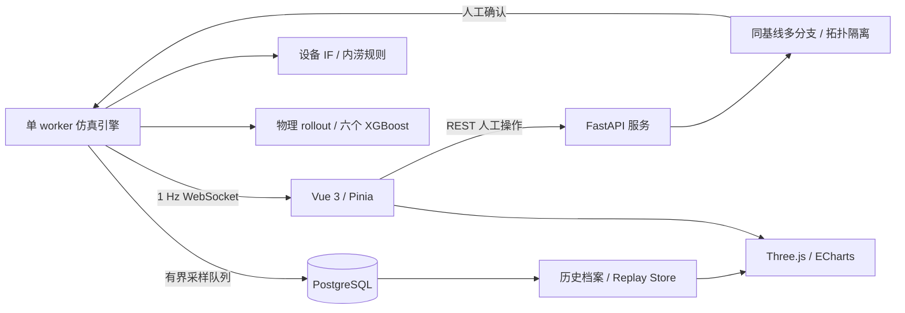

# TwinCitySafe V1.0 技术说明

平台以同一个仿真时钟连接监测、预测、人工处置和历史复盘。M10 增量完善展示与部署；现有引擎、预测服务、管网图和回放未重写。

| 层 | 实现 | 关键边界 |
|---|---|---|
| 页面 | Vue 3、TypeScript、Pinia、Vue Router，六路由懒加载 | 全局一个实时连接；历史数据与实时状态隔离 |
| 三维 | Three.js、OrbitControls、CSS2DRenderer、OutlinePass | 同实例更新对象；高/中/低质量不新建场景 |
| 图表 | ECharts，统一主题，setOption 更新 | 各图单位独立；曲线不产生物理状态 |
| 后端 | FastAPI、Pydantic、SQLAlchemy、Alembic | 单 worker 内存引擎；启动不训练、不恢复旧事故 |
| 数据库 | PostgreSQL 资产、遥测、预测、方案、档案与工单 | 队列有界，断库不承诺补齐全部历史 |
| 实时 | 1 Hz WebSocket，断线重连和 REST 快照 | 一个权威时钟；暂停心跳不伪造样本 |
| 演示 | 只读 readiness、显式 Demo start/reset/pause/resume/speed | 生产需 DEMO_MODE，冲突拒绝，Reset 不删除历史 |

设备模块根据温度、振动、电流、转速和效率计算健康指数，并加载 Isolation Forest；模型异常与规则健康分别展示。内涝按有效汇水面积、径流、自然排水和资产额定泵能力进行体积守恒演化，泵故障与启动过渡沿用设备状态。

六个 XGBoost 原生 JSON 分别预测 10/20/30 分钟水位和风险。共享 30 维特征合同，60000 样本按 250 独立场景划分，170/40/40 场景对应训练/验证/测试。原始模型及测试报告保留；新人工干预不能以原测试精度替代实际回测。TreeSHAP 是模型贡献，物理与 ML 一致度不是概率。

应急比较从同一物理基线复制 BASELINE、A、B、C，不干预真实引擎，不输出自动赢家。执行前检查比较过期和资源状态，人工确认后随真实仿真时钟启动泵、封控入口；持续强降雨可超过排水能力，不能保证排空。

地下管网以图搜索追踪上下游、阀门和建筑影响。泄漏由压力 / 流量残差与拓扑一致性定位；不是高精度水力求解，不调用内涝 ML。隔离可降低泄漏但保留停水建筑。

事故档案聚合原始快照、动作与日志，演示先完成工单，再在场景稳定时人工关闭（当前关闭 API 不强制工单完成）。关闭解除活动引用并保留物理末态；Reset 将未关闭事故标为 ABORTED。Replay Store 按历史 ID 对齐连续与离散字段，缺失为 unknown；一个 RAF 和可复用 Three 场景显示历史，不回写实时引擎。报告使用持久化事实模板生成，不调用 LLM。

本地构建所有脚本、图标、字体回退和模型资源。实际 GPU 性能需比赛机器复验；本地 SwiftShader 数据仅用于软件渲染与资源稳定性记录。
